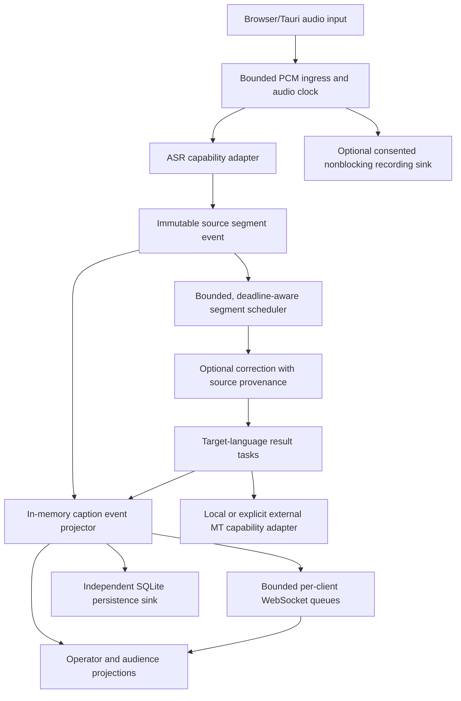

# LangTextFlow realtime runtime architecture v2 (proposed)

Status: **proposed**, migration is incremental. Parent issue: [#154](https://github.com/JDeun/LangTextFlow/issues/154). Date: 2026-10-14.

This ADR defines **program** architecture. It does not describe or replace the GitHub Actions scientific experiment conveyor.

## Product invariants

1. **All directed language pairs** among Korean, English and Japanese remain in scope; especially English/Japanese missionary speech → Korean audience captions. A small local installation may offer only a verified subset, but it must label the others unavailable rather than advertise unsupported translation.
2. **Original ASR text is a distinct track.** Never substitute source text as a translation; never silently mutate the original via LLM or dictionary rewriting.
3. **Do not block new source captions** on LLM correction, any target MT, a slow audience socket, database access or optional recording.
4. **Per-target failure isolation:** one failed model, target language, or audience connection must not halt remaining targets and source.
5. Low-spec deployment is CPU/offline-first (8GB target; 4GB experimental) and uses **bounded** model concurrency, memory, queues and session cancellation. These are unverified hardware classes until #107.
6. Distinguish CI/code correctness, reproducible inference, domain quality and actual field readiness. Field readiness requires licensed real audio and independent multilingual/human quality review.

## Maintain a modular monolith

Keep FastAPI + Python async runtime + SQLite for session metadata and stored events, React/Tauri UI, and independently swappable ASR/MT providers. Do **not** introduce distributed brokers, microservices or a paid service dependency to fix in-process scheduling.

*The diagram is the target. Existing `CaptionRuntime._publish` still awaits hub fan-out and `CaptionPipeline` still serializes segments until #155/#159 land.*

## Versioned event/data contract

Transition from `TranscriptEvent(stage, version, translations)` without destroying existing stores or audience APIs:

- Source event: `session_id/generation`, `segment_id`, `source_revision`, `source_language`, `text`, `start_ms/end_ms`, `is_final`, `model_provenance`.
- Target event: `session_id/generation`, `segment_id`, `source_revision`, `target_language`, `target_revision`, `status` (`pending|available|failed|timed_out|unsupported|expired`), optional `translated_text`, model/provenance and observed latency.
- Monotonic projector: late target updates for an older source revision or a prior session generation are discarded. Distinct source and translated tracks are never conflated. `COMMITTED` source finalization does not mean all target languages succeeded.
- Existing legacy `TranscriptEvent` and WebSocket snapshot shapes remain supported during the migration. Add adapters/versioned payloads first, then migrate the consumers and persistence; do not change producer + consumer blindly in one PR.
- Persist model revision/licensing and the captured glossary hash when necessary, with operator consent/privacy constraints respected.

## Scheduler and overload policy (#155, #156)

- Bound admitted source segments and pending target tasks. Avoid unbounded `create_task`, unbounded model inference, and accumulated stale retries.
- A slow target can time out or be marked unavailable; it must not block another target or subsequent source captions. The low-resource profile has a stricter compute budget.
- Coalesce revisions for the **same uncommitted** source segment only; preserve distinct repeated utterances as distinct IDs.
- Track: arrival/first-source p50/p95, queue age, correction p95, *per-target* MT p50/p95/p99, expired/dropped counts, transport backpressure, CPU/RSS, live RTF.
- Preserve failure evidence. If overload requires dropping an untranslated task, expose explicit expired/unavailable state. Never fabricate translations.

## Provider capability contract (#157, #158, #160)

An adapter must declare: supported input/output language pairs, actual streaming vs chunked recognition, observed timestamps and their origin, native hotword support or `unsupported`, model license/weight availability, cache/offline status, CPU/RAM load and quantization, lifecycle, concurrency safety, and error classes. CPU CTranslate2/Marian/M2M100 are **research candidates**, not currently production-ready providers. Preserve the negative OPUS tc-big evidence in #119.

Glossary policy: snapshot per session; filter by verified **source language**, target language and preset/project scope. Separate native ASR bias, deterministic correction, prompt hints, and target terminology scoring. No arbitrary string substitution to force semantic success.

## Sink boundaries and lifecycle (#159, #161)

- Project source updates to in-memory state **without awaiting** WebSocket, DB or disk. Send to each client via a bounded queue with explicit slow-client eviction and authorized reconnection/snapshot.
- Preserve ordered version updates per segment, privacy boundaries, audio socket exclusivity, recording consent and secure audience join.
- Fence all old tasks on session restart with generation IDs; drain within budget, cancel workers, and report incomplete storage rather than pretending success.
- Keep UI language selection independent of source, surface per-target availability and errors rather than `[language] + original-text` fake translations.

## Migration plan

| Phase | Implement | Gate |
| --- | --- | --- |
| 0 | Current baseline + exact failing-case tests | Preserve regression and negative model evidence |
| 1 | Bounded per-target calls, timeouts and errors (#162) | 2-language mock failure/timeout; low-RAM max concurrency |
| 2 | Source-scoped correction + MT hints (#163) | KO/EN/JA collision tests, no forced rewrite |
| 3 | Revision-aware segment/target event protocol (#155/#156) | Slow translation does not stall another segment; out-of-order target replies ignored |
| 4 | Nonblocking projector/sinks (#159) | Stalled WebSocket/SQLite/disk no source-caption stall |
| 5 | Local CPU translation adapter with provider capabilities (#157/#158) | Real licensed, pinned KO/EN/JA inference; no unsupported pairs claimed |
| 6 | Frontend runtime status and CPU low-spec integration (#161/#106) | Offline 8GB/4GB qualification, real 30/60/90-min soak, human bilingual acceptance |

## Scope of existing GitHub issues

Keep acceptance issues open: #126 (six-way missionary needs), #106/#107 (budget hardware), #139/#130 (actual glossary effectiveness), #100/#101/#127/#128 (real speech/model evidence), #104/#78-#81 (post-event). Technical architecture is tracked by #154-#161. Existing #110 Korean-only umbrella was superseded by #127/#158, but **its model-specific children #111-#115 and all past failures are preserved**.

This ADR is **not proof of implementation**. Every phase requires a reviewable code PR and independently green exact-head CI before merge.
